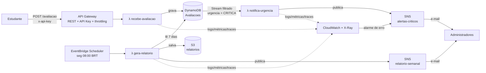

# Arquitetura — TC4 Feedback

Plataforma serverless na AWS (`us-east-2`) para receber avaliações de aulas, notificar admins sobre itens críticos e gerar relatório semanal.

## Diagrama



## Funções (responsabilidade única)

| Função | Gatilho | Responsabilidade |
|---|---|---|
| `recebe-avaliacao` | API Gateway `POST /avaliacao` | Validar entrada, classificar urgência, persistir |
| `notifica-urgencia` | DynamoDB Stream (filtro `CRITICA`) | Montar e enviar o alerta (descrição, urgência, data de envio) |
| `gera-relatorio` | EventBridge Scheduler (semanal) | Agregar a semana: média, qtd por dia, qtd por urgência, lista de avaliações |

A função de recebimento **não sabe** que existe notificação: o desacoplamento é feito pelo Stream com filtro de evento.

## Regra de urgência

| Nota | Urgência |
|---|---|
| 0–3 | CRITICA (dispara alerta) |
| 4–6 | MEDIA |
| 7–10 | BAIXA |

## Modelo de dados (DynamoDB `Avaliacoes`)

| Atributo | Tipo | Exemplo |
|---|---|---|
| `dia` (PK) | String (dia no horário de Brasília) | `2026-10-27` |
| `criadoEm#id` (SK) | String | `2026-10-27T14:03:11Z#9f1c…` |
| `id` | String (UUID) | |
| `descricao` | String | |
| `nota` | Number | `2` |
| `urgencia` | String | `CRITICA` |
| `dataEnvio` | String (ISO-8601) | |

PK por dia → o relatório faz 7 `Query` (uma por dia), sem `Scan`.

## Contrato de entrada

```http
POST /avaliacao
x-api-key: <chave>
Content-Type: application/json

{ "descricao": "Áudio da aula cortando", "nota": 2 }
```

Respostas: `201` (criado), `400` (nota fora de 0–10 ou descrição vazia), `403` (sem API key).

## Segurança e governança

- **IAM**: uma role por função, permissão mínima (ex.: `recebe-avaliacao` só faz `PutItem` na tabela).
- **Acesso humano**: root com MFA; uso diário via usuário/role administrativa.
- **API**: API Key + usage plan (throttling) no API Gateway.
- **Dados**: criptografia em repouso (DynamoDB, S3, SNS com KMS); S3 com bloqueio de acesso público. O tópico `alertas-criticos` usa chave KMS própria (`alias/tc4-alertas`) para aceitar publicações dos alarmes do CloudWatch.
- **CI/CD**: GitHub Actions autentica via OIDC (sem chaves de acesso no repositório).
- **Custo**: AWS Budgets com alerta.

## Monitoramento

- CloudWatch Logs (retenção 14 dias) e logs estruturados em JSON.
- Métricas de negócio via Embedded Metric Format (namespace `TC4Feedback`: `Avaliacoes` e `Nota` por `Urgencia`).
- X-Ray tracing nas 3 funções.
- Alarme: `Errors > 0` em qualquer função → SNS `alertas-criticos`.
- Dashboard CloudWatch: invocações, erros, duração, avaliações por urgência.

## Stack

- Java 21 + Quarkus (`quarkus-amazon-lambda`, `quarkus-amazon-lambda-rest`)
- Lambda em JVM com **SnapStart** (reduz cold start sem precisar de build nativo)
- IaC: AWS SAM (`template.yaml` único)
- CI/CD: GitHub Actions → `sam build && sam deploy`

## Estrutura do repositório

```
tc4-feedback/
├── pom.xml                      # parent (módulos + versões)
├── core/                        # domínio: Avaliacao, Urgencia, regra de classificação
├── recebe-avaliacao/            # λ HTTP
├── notifica-urgencia/           # λ DynamoDB Stream
├── gera-relatorio/              # λ agendada
├── template.yaml                # infra SAM (tabela, SNS, S3, API, scheduler, alarmes)
├── .github/workflows/deploy.yml
├── docs/
│   └── ARQUITETURA.md
└── README.md
```
